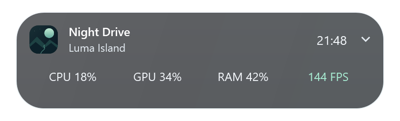
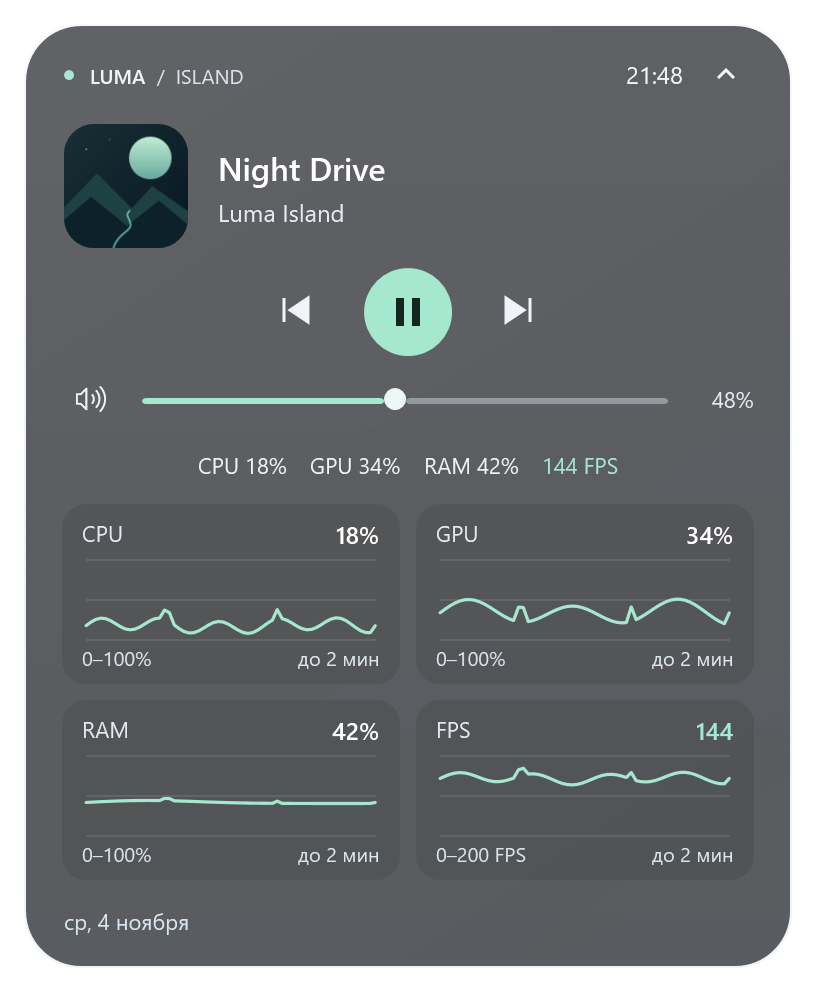

# Luma Island

[](https://github.com/pyrrhuladev/luma-island/actions/workflows/ci.yml)

A compact desktop island for Windows: media controls, system volume, optional performance metrics, and mini charts in a native C#/WPF interface.

Небольшая капсула поверх окон Windows. Показывает текущий трек, управляет музыкой и громкостью, раскрывается в панель с дополнительными показателями. Нужные компоненты можно включать по отдельности.

[Скачать последнюю версию](https://github.com/pyrrhuladev/luma-island/releases/latest) · [История изменений](CHANGELOG.md)





*Скриншоты с демонстрационными данными.*

## Установка и обновление

Нужна **Windows 10 22H2 или Windows 11, x64**. Portable-сборка включает .NET; устанавливать его отдельно для запуска не требуется.

1. Скачайте portable ZIP со страницы [Releases](https://github.com/pyrrhuladev/luma-island/releases/latest).
2. Распакуйте архив целиком в папку, где будет храниться программа.
3. Запустите `Luma.Island.exe`. Права администратора не нужны.

Сохраняйте EXE и все DLL вместе. Перед обновлением выберите **«Выйти из Luma Island»** в меню старой версии, затем распакуйте и запустите новую. Настройки положения, оформления и компонентов сохраняются в профиле пользователя.

Если автозапуск уже включён, один раз запустите новую portable-версию вручную после выхода из старой: сохранённый путь обновится.

## Возможности

- **Музыка:** название трека, исполнитель, обложка, пауза, предыдущий и следующий трек через системную медиасессию Windows. Обложки обрезаются по центру с сохранением пропорций.
- **Системная громкость:** ползунок и отключение звука.
- **Время, дата и батарея:** индикатор батареи появляется при работе от аккумулятора и скрывается при подключении питания.
- **Положение:** свободное перетаскивание, девять готовых позиций, выбор монитора и закрепление. Положение восстанавливается после перезапуска; при отключении выбранного экрана используется доступный основной.
- **Оформление:** непрозрачный матовый режим и тонированное стекло с прозрачностью фона 10%, 24%, 35%, 50%, 65% или 75%. В режиме стекла фон не размывается; текст и управление сохраняют собственную непрозрачность.
- **Дополнительные показатели:** CPU, GPU, RAM и FPS. GPU показывает загрузку самого занятого графического движка, а не усреднение по всей видеокарте.
- **Мини-графики:** история выбранных показателей в раскрытой панели — до 60 точек за две минуты. Недоступные значения отображаются пропусками; при смене игры история FPS начинается заново.

CPU, GPU, RAM, FPS и мини-графики по умолчанию выключены. Их можно выбрать в меню **«Компоненты»**; для графиков включите **«Расширенный режим: мини-графики»** и нужные показатели.

## Управление

| Действие | Управление |
| --- | --- |
| Раскрыть или свернуть панель | Щелчок по капсуле или `Ctrl+Alt+Space` |
| Переместить | Перетащить свёрнутую капсулу или заголовок раскрытой панели |
| Выбрать экран, готовую позицию или закрепление | Правый щелчок → **«Положение»** |
| Изменить вид и состав панели | Правый щелчок → **«Оформление»** / **«Компоненты»** |
| Показать или скрыть окно | Двойной щелчок по значку в трее |
| Открыть меню в трее | Правый щелчок по значку |
| Завершить программу | **«Выйти из Luma Island»** в меню |

Для свободного перетаскивания снимите отметку **«Закрепить положение»**.

### Автозапуск

В меню капсулы или трея выберите **«Запускать вместе с Windows»**. По умолчанию этот режим выключен. Галочка включает запуск после входа в Windows; повторное нажатие отключает его.

Если автозапуск запрещён средствами Windows, Luma предложит открыть системный раздел **«Автозагрузка»**. Перенос программы в новую папку сохраняет это системное отключение.

Перед удалением portable-папки выключите автозапуск и завершите программу.

## FPS и NVIDIA FrameView

Для измерения FPS нужен **уже установленный NVIDIA FrameView SDK**. Его DLL не входят в этот репозиторий и portable-архив. Без SDK или доступных кадров отображается **«FPS —»** с пояснением в подсказке. Частота обновления монитора не используется вместо FPS игры.

Включение FPS запускает сбор данных через FrameView и может добавлять процессы NVIDIA. Выключение закрывает сессию Luma; службой и вспомогательными процессами управляет сам SDK. Эти процессы могут оставаться в памяти после выключения FPS, поэтому их расход следует учитывать вместе с расходом Luma.

## Ресурсы и данные

Основной интерфейс работает на WPF в одном процессе. Музыка и громкость обновляются по системным событиям; часы и батарея — раз в минуту. CPU, GPU и RAM опрашиваются раз в две секунды только при включённых компонентах. Мини-графики используют те же измерения и не создают отдельный таймер; в свёрнутом виде линии не перерисовываются.

Расход зависит от компонентов, состояния панели, оборудования и внешнего источника FPS. Методика и результаты замеров описаны в [docs/performance.md](docs/performance.md); они не являются обещанием одинакового расхода на каждом ПК.

Настройки и журнал ошибок хранятся локально в профиле текущего пользователя. История графиков находится только в оперативной памяти. Название трека и обложка читаются из медиасессии Windows; в коде Luma нет отправки этих данных на сервер. Работа и сетевые обращения внешнего SDK NVIDIA определяются самим SDK.

## Ограничения

- Музыка доступна у плееров, которые публикуют системную медиасессию Windows. Набор доступных команд зависит от плеера.
- Недоступные системные показатели показывают прочерк; FPS зависит от установленного FrameView SDK и наличия кадров приложения.
- Для стекла используется тонированный полупрозрачный фон. На высокой прозрачности читаемость зависит от содержимого под капсулой.
- В текущую версию не входят перемотка трека, история буфера обмена и автоматическое обновление.
- Поддерживается Windows x64. Версий для Linux, macOS и ARM64 пока нет.

## Сборка и проверки

Для разработки нужны Windows и **.NET 10 SDK**. Из корня репозитория:

```powershell
powershell -File .\build.ps1
powershell -File .\build.ps1 -Publish
powershell -File .\tools\Test.ps1
```

Portable-папка появится в `artifacts/Luma-Island-<версия>`. Сборка предназначена для `win-x64` и включает среду выполнения .NET.

`powershell -File .\tools\Package.ps1` создаёт проверенный ZIP с документацией, лицензиями зависимостей и SHA-256 в `artifacts/release/`. Публичные сборки пока не имеют цифровой подписи.

Проверки охватывают настройки, положение панели, расчёты показателей, историю графиков, обрезку обложек и автозапуск. Тесты автозапуска используют отдельные временные ключи реестра и удаляют их после проверки.

## Участие в проекте

Форки, pull request, идеи и вопросы приветствуются. Открыть обсуждение или сообщить об ошибке можно в [Issues](https://github.com/pyrrhuladev/luma-island/issues). Как подготовить изменение и проверить его — в [CONTRIBUTING.md](CONTRIBUTING.md). Общаемся по [правилам проекта](CODE_OF_CONDUCT.md).

## Лицензия и благодарности

Исходный код Luma Island распространяется по лицензии [MIT](LICENSE). NVIDIA FrameView SDK — отдельный продукт NVIDIA со своей лицензией; лицензия Luma не распространяется на него.

Сведения о включённых .NET/WPF и Windows SDK bindings: [сторонние компоненты и лицензии](docs/THIRD_PARTY_NOTICES.md).

Спасибо [Istel](https://github.com/rud1x/Istel) за идею и ориентир. Luma Island — независимая реализация на C#/WPF со своим набором функций. Интерфейс и системные интеграции используют Microsoft .NET, WPF и API Windows.
