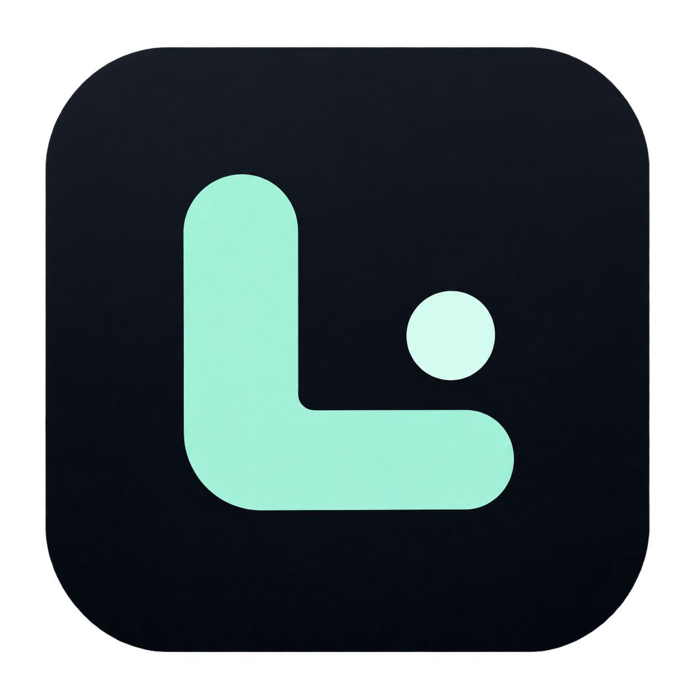
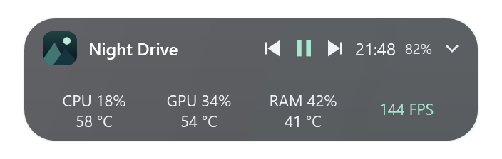

# Luma Island

[](https://github.com/pyrrhuladev/luma-island/actions/workflows/ci.yml)

A quiet gaming HUD for Windows: media controls, system volume, optional performance metrics, and mini charts in a native C#/WPF interface.

Компактный «Тихий HUD» поверх окон Windows. Крупный FPS, выбранные показатели и небольшие кнопки музыки доступны в свёрнутом виде; подробная панель раскрывается по нажатию. Фон можно сделать прозрачнее, а нужные компоненты — включать по отдельности.

[Скачать последнюю версию](https://github.com/pyrrhuladev/luma-island/releases/latest) · [История изменений](CHANGELOG.md)


*Скриншоты с демонстрационными данными.*

## Установка и обновление

Нужна **Windows 10 22H2 или Windows 11, x64**. Portable-сборка включает .NET; устанавливать его отдельно для запуска не требуется.

1. Скачайте portable ZIP со страницы [Releases](https://github.com/pyrrhuladev/luma-island/releases/latest).
2. Распакуйте архив целиком в папку, где будет храниться программа.
3. Запустите `Luma.Island.exe`. Права администратора не нужны.

Сохраняйте EXE и все DLL вместе. Перед обновлением выберите **«Выйти из Luma Island»** в меню старой версии, затем распакуйте и запустите новую. Настройки положения, оформления и компонентов сохраняются в профиле пользователя.

Если автозапуск уже включён, один раз запустите новую portable-версию вручную после выхода из старой: сохранённый путь обновится.

## Возможности

- **Музыка:** название трека, исполнитель, обложка, пауза, предыдущий и следующий трек через системную медиасессию Windows. Название, обложка и небольшие кнопки доступны и в свёрнутом HUD; исполнитель скрывается только в компактном режиме. Щелчок по кнопкам не раскрывает панель. Обложки обрезаются по центру с сохранением пропорций.
- **Системная громкость:** ползунок и отключение звука.
- **Время, дата и батарея:** индикатор батареи появляется при работе от аккумулятора и скрывается при подключении питания.
- **Положение:** свободное перетаскивание, девять готовых позиций, выбор монитора и закрепление. Положение восстанавливается после перезапуска; при отключении выбранного экрана используется доступный основной.
- **Тихий HUD:** интерфейс без логотипа на панели, с крупным FPS, отдельными показателями CPU/GPU/RAM и строкой музыки. Значок приложения и трея сохранён.
- **Оформление:** непрозрачный матовый режим и тонированное стекло с регулируемой прозрачностью фона от 0% до 95%. В режиме стекла фон не размывается; текст и управление сохраняют собственную непрозрачность. [Настройка оформления](docs/appearance.md).
- **Компактная капсула:** меньшая ширина и отступы с сохранёнными названием трека и кнопками музыки. По нажатию открывается полноразмерная панель.
- **Профили игр:** отдельные положение, оформление, масштаб и компоненты для каждой игры. Автопереключение включается по желанию; изменения активного HUD сохраняются в профиль игры. [Настройка профилей](docs/profiles.md).
- **Пропуск кликов в игру:** HUD остаётся видимым, а мышь работает с окном под ним. `Ctrl+Alt+I` возвращает управление панелью; тот же результат даёт щелчок по значку Luma в трее. Режим включается отдельно и запоминается.
- **Дополнительные показатели:** CPU, GPU, RAM и FPS. GPU показывает загрузку самого занятого графического движка, а не усреднение по всей видеокарте.
- **Температура GPU:** отдельный переключатель для температуры ядра видеокарты NVIDIA через установленный драйвер. Можно показывать только градусы либо нагрузку и температуру в две строки.
- **Температуры CPU / RAM:** отдельные переключатели и необязательный локальный модуль с PawnIO. [Настройка и ограничения совместимости](docs/sensors.md).
- **Мини-графики:** история выбранных показателей в раскрытой панели — до 60 точек за две минуты. Недоступные значения отображаются пропусками; при смене игры история FPS начинается заново.

CPU, GPU, RAM, FPS, все температуры и мини-графики по умолчанию выключены. Их можно выбрать в меню **«Компоненты»**; для графиков включите **«Расширенный режим: мини-графики»** и нужные показатели нагрузки.

### Температура GPU

Включите **«Компоненты» → «Температура GPU»**. Дополнительная программа и права администратора не нужны: Luma использует NVML из уже установленного драйвера NVIDIA. Обновление выполняется раз в две секунды, в том же фоновом опросе, что и нагрузка. При отключении температуры сессия NVML закрывается; если все показатели выключены, таймер сбора останавливается.

Показывается температура ядра, а при нескольких поддерживаемых NVIDIA GPU — наибольшая из доступных. Это не hotspot и не температура видеопамяти. Если датчик или совместимый драйвер недоступны, появится **«— °C»**, причина — в подсказке. Поддержка конкретной видеокарты определяется при чтении. На AMD/Intel этот источник не работает. Температура не подменяет процентную шкалу мини-графиков.

Температуры CPU и RAM доступны через необязательный модуль: [настройка](docs/sensors.md).

### Компактный режим

В меню HUD или значка в трее включите **«Оформление» → «Компактная капсула»**. Название трека, кнопки музыки, время и выбранные показатели остаются. Нагрузка и температура CPU/GPU/RAM помещаются в две строки своей колонки. Раскрытая панель сохраняет полный размер; повторное нажатие возвращает компактный HUD.

Режим запоминается после перезапуска и работает с матовым оформлением и стеклом. Он меняет размеры интерфейса, сохраняя выбранные компоненты и источники данных.



*Демонстрационные данные в компактном режиме.*

### Обложки при переключении треков

Название трека обновляется сразу. Luma проверяет новую обложку при событиях плеера, даже если текст трека не изменился. Для отсутствующей, временно недоступной или ещё не обновившейся картинки выполняется до четырёх чтений со свежими медиасвойствами. Поздние результаты предыдущего трека и отключённой медиасессии отбрасываются. Постоянного опроса обложек в фоне нет.

## Управление

| Действие | Управление |
| --- | --- |
| Раскрыть или свернуть панель | Щелчок по названию трека или свободной части капсулы |
| Пауза, предыдущий или следующий трек | Маленькие кнопки в капсуле либо кнопки раскрытой панели |
| Переместить | Перетащить свёрнутую капсулу или заголовок раскрытой панели |
| Выбрать экран, готовую позицию или закрепление | Правый щелчок → **«Положение»** |
| Изменить вид и состав панели | Правый щелчок → **«Оформление»** / **«Компоненты»** |
| Переключить пропуск кликов в игру | `Ctrl+Alt+I` либо **«Пропускать клики в игру»** в меню HUD или трея |
| Показать или скрыть капсулу | `Ctrl+Alt+Space` либо пункт контекстного меню **«Скрыть в трей»** / **«Показать капсулу»** |
| Показать HUD и вернуть управление мышью | Щелчок по значку в трее или повторный запуск Luma |
| Открыть меню в трее | Правый щелчок по значку |
| Завершить программу | **«Выйти из Luma Island»** в меню |

Для свободного перетаскивания снимите отметку **«Закрепить положение»**.

Капсула не показывается в Alt+Tab и панели задач. Для доступа используйте трей или горячую клавишу. Для нажатий кнопок, перетаскивания и управления клавиатурой выключите пропуск кликов.

### Пропуск кликов в игру

В меню HUD или значка в трее включите **«Пропускать клики в игру»** либо нажмите `Ctrl+Alt+I`. Панель свернётся, останется поверх окна и будет пропускать мышь к нему. Показатели, обложки и состояние музыки продолжают обновляться с прежней частотой.

Для управления музыкой или настройками нажмите `Ctrl+Alt+I` ещё раз либо щёлкните по значку Luma в трее. Повторный запуск программы также показывает уже работающий HUD и возвращает управление. `Ctrl+Alt+Space` сохраняет своё назначение: скрывает или показывает HUD, сохраняя режим пропуска кликов.

По умолчанию пропуск кликов выключен; выбор сохраняется при перезапуске. Если `Ctrl+Alt+I` занята другой программой, меню объяснит конфликт, а управление останется доступно через трей. Если недоступны и горячая клавиша, и значок трея, Luma оставит HUD управляемым. Прозрачность фона настраивается отдельно и не определяет, получает ли панель клики.

### Автозапуск

В меню капсулы или трея выберите **«Запускать вместе с Windows»**. По умолчанию этот режим выключен. Галочка включает запуск после входа в Windows; повторное нажатие отключает его.

Если автозапуск запрещён средствами Windows, Luma предложит открыть системный раздел **«Автозагрузка»**. Перенос программы в новую папку сохраняет это системное отключение.

Перед удалением portable-папки выключите автозапуск и завершите программу.

## FPS и NVIDIA FrameView

Для измерения FPS нужен **уже установленный NVIDIA FrameView SDK**. Его DLL не входят в этот репозиторий и portable-архив. Без SDK или доступных кадров отображается **«FPS —»** с пояснением в подсказке. Частота обновления монитора не используется вместо FPS игры.

Включение FPS запускает сбор данных через FrameView и может добавлять процессы NVIDIA. Выключение закрывает сессию Luma; службой и вспомогательными процессами управляет сам SDK. Эти процессы могут оставаться в памяти после выключения FPS, поэтому их расход следует учитывать вместе с расходом Luma.

## Ресурсы и данные

Основной интерфейс работает на WPF в одном процессе. Музыка и громкость обновляются по системным событиям; часы и батарея — раз в минуту. CPU, GPU и RAM опрашиваются раз в две секунды только при включённых компонентах. Мини-графики используют те же измерения и не создают отдельный таймер; в свёрнутом виде линии не перерисовываются.

Скрытие в трей приостанавливает опрос нагрузки, температур и FPS, сохраняя выбор компонентов. После восстановления опрос возобновляется. Необязательная служба температур CPU/RAM работает отдельным процессом; её расход нужно учитывать вместе с интерфейсом. [Подробности модуля](docs/sensors.md).

Расход зависит от компонентов, состояния панели, оборудования и внешнего источника FPS. Методика и результаты замеров описаны в [docs/performance.md](docs/performance.md); они не являются обещанием одинакового расхода на каждом ПК.

Настройки и журнал ошибок хранятся локально в профиле текущего пользователя. История графиков находится только в оперативной памяти. Название трека и обложка читаются из медиасессии Windows; в коде Luma нет отправки этих данных на сервер. Работа и сетевые обращения внешнего SDK NVIDIA определяются самим SDK.

## Ограничения

- Музыка доступна у плееров, которые публикуют системную медиасессию Windows. Набор доступных команд зависит от плеера.
- Недоступные системные показатели показывают прочерк; FPS зависит от установленного FrameView SDK и наличия кадров приложения.
- Для стекла используется тонированный полупрозрачный фон. На высокой прозрачности читаемость зависит от содержимого под капсулой.
- В текущую версию не входят перемотка внутри трека, история буфера обмена, автоматическое обновление и управление разгоном. [Предложение по игровому бусту](docs/boost-design.md).
- Поддерживается Windows x64. Версий для Linux, macOS и ARM64 пока нет.

## Сборка и проверки

Для разработки нужны Windows и **.NET 10 SDK**. Из корня репозитория:

```powershell
powershell -File .\build.ps1
powershell -File .\build.ps1 -Publish
powershell -File .\tools\Test.ps1
```

Portable-папка появится в `artifacts/Luma-Island-<версия>`. Сборка предназначена для `win-x64` и включает среду выполнения .NET.

`powershell -File .\tools\Package.ps1` создаёт проверенный ZIP с документацией, лицензиями зависимостей и SHA-256 в `artifacts/release/`. Публичные сборки пока не имеют цифровой подписи.

Проверки охватывают настройки, положение панели, расчёты показателей, историю графиков, обрезку обложек и автозапуск. Тесты автозапуска используют отдельные временные ключи реестра и удаляют их после проверки.

## Участие в проекте

Форки, pull request, идеи и вопросы приветствуются. Открыть обсуждение или сообщить об ошибке можно в [Issues](https://github.com/pyrrhuladev/luma-island/issues). Как подготовить изменение и проверить его — в [CONTRIBUTING.md](CONTRIBUTING.md). Общаемся по [правилам проекта](CODE_OF_CONDUCT.md).

## Лицензия и благодарности

Исходный код Luma Island распространяется по лицензии [MIT](LICENSE). NVIDIA FrameView SDK — отдельный продукт NVIDIA со своей лицензией; лицензия Luma не распространяется на него.

Сведения о включённых .NET/WPF и Windows SDK bindings: [сторонние компоненты и лицензии](docs/THIRD_PARTY_NOTICES.md).

Спасибо [Istel](https://github.com/rud1x/Istel) за идею и ориентир. Luma Island — независимая реализация на C#/WPF со своим набором функций. Интерфейс и системные интеграции используют Microsoft .NET, WPF и API Windows.
