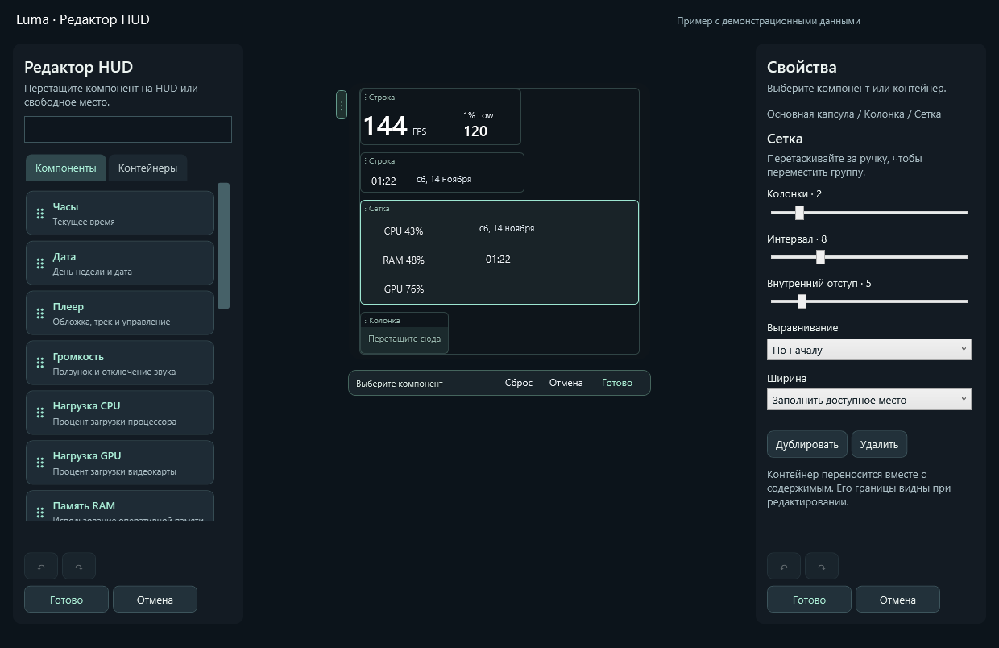

# Luma Island

[](https://github.com/pyrrhuladev/luma-island/actions/workflows/ci.yml)

A quiet gaming HUD for Windows: media controls, system volume, optional performance metrics, and mini charts in a native C#/WPF interface.

Компактный «Тихий HUD» поверх окон Windows. Показатели, мини-графики, музыку и громкость можно собирать в капсулы в экранном редакторе. Фон можно сделать прозрачнее.

[Скачать последнюю версию](https://github.com/pyrrhuladev/luma-island/releases/latest) · [История изменений](CHANGELOG.md)


*Скриншоты с демонстрационными данными.*

## Установка и обновление

Нужна **Windows 10 22H2 или Windows 11, x64**. Portable-сборка включает .NET; устанавливать его отдельно для запуска не требуется.

1. Скачайте portable ZIP со страницы [Releases](https://github.com/pyrrhuladev/luma-island/releases/latest).
2. Распакуйте архив целиком в папку, где будет храниться программа.
3. Запустите `Luma.Island.exe`. Права администратора не нужны.

Сохраняйте EXE и все DLL вместе. Перед обновлением выберите **«Выход»** в меню старой версии, затем распакуйте и запустите новую. Настройки положения, оформления и компонентов сохраняются в профиле пользователя.

Если автозапуск уже включён, один раз запустите новую portable-версию вручную после выхода из старой: сохранённый путь обновится.

## Возможности

- **Музыка.** Название трека, исполнитель, обложка, пауза, предыдущий и следующий трек через системную медиасессию Windows. Обложки обрезаются по центру с сохранением пропорций.
- **Системная громкость:** отключаемый ползунок с кнопкой звука и отдельная регулировка колёсиком над HUD.
- **Время, дата и батарея:** индикатор батареи появляется при работе от аккумулятора и скрывается при подключении питания.
- **Положение:** свободное перетаскивание, девять готовых позиций, выбор монитора и закрепление. Положение восстанавливается после перезапуска; при отключении выбранного экрана используется доступный основной.
- **Экранный редактор.** Перетаскивайте компоненты с панели выбора, собирайте вложенные строки, колонки и сетки. Перестройка видна во время переноса. Состав и координаты капсул сохраняются в общих настройках или профиле игры.
- **Тихий HUD:** интерфейс без логотипа на панели, с крупным FPS, отдельными показателями CPU/GPU/RAM и строкой музыки. Значок приложения и трея сохранён.
- **Единые настройки.** Графитовые карточки, переключатели и поиск по разделам. `Ctrl+F` открывает поиск, `Ctrl+S` сохраняет общий черновик. Внешний вид можно оценить на тёмном или светлом фоне в предпросмотре. [Настройки](docs/settings.md)
- **Тихие предупреждения:** отключаемый цветной маркер температуры CPU/GPU/RAM и серии задержавшихся кадров. Категории и пороги выбираются отдельно; звуков и всплывающих уведомлений нет.
- **Оформление.** Тонированное стекло с прозрачностью фона от 0% до 95% и общий масштаб HUD от 75% до 150%. Текст и кнопки сохраняют собственную непрозрачность. [Настройка оформления](docs/appearance.md).
- **Профили игр:** отдельные положение, оформление, масштаб и компоненты для каждой игры. Автопереключение включается по желанию; изменения активного HUD сохраняются в профиль игры. [Настройка профилей](docs/profiles.md).
- **Пропуск кликов в игру:** HUD остаётся видимым, а мышь работает с окном под ним. `Ctrl+Alt+I` возвращает управление панелью; тот же результат даёт щелчок по значку Luma в трее. Режим включается отдельно и запоминается.
- **Дополнительные показатели:** CPU, GPU, RAM и FPS. GPU показывает загрузку самого занятого графического движка, а не усреднение по всей видеокарте.
- **1% Low и время кадра.** Оба показателя можно включить отдельно. График времени кадра показывает интервалы в миллисекундах прямо в HUD. [Настройка и источник данных](docs/frame-timing.md)
- **Температура GPU:** отдельный компонент показывает температуру ядра видеокарты NVIDIA через установленный драйвер.
- **Температуры CPU / RAM:** отдельные компоненты и необязательный локальный модуль с PawnIO. [Настройка и ограничения совместимости](docs/sensors.md).
- **Мини-графики.** До 60 точек истории выбранных CPU, GPU, RAM и FPS за две минуты. Недоступные значения отображаются пропусками. При смене игры история FPS начинается заново.

CPU, GPU, RAM, FPS, 1% Low, график времени кадра, температуры и мини-графики можно перетащить с панели **«Компоненты»** в режиме **«Редактировать HUD…»**. Каждый мини-график добавляется отдельно от числового показателя.

Щёлкните правой кнопкой по HUD или значку в трее и выберите **«Настройки…»**. В том же меню доступна команда **«Редактировать HUD…»**. Тихие предупреждения по умолчанию выключены. Для отмеченных предупреждений сбор данных может работать и при скрытом числовом показателе.

### Температура GPU

Перетащите **«Температура GPU»** с панели компонентов в режиме **«Редактировать HUD…»**. Luma читает датчик через NVML из установленного драйвера NVIDIA с правами обычного пользователя. Обновление выполняется раз в две секунды, в том же фоновом опросе, что и нагрузка. Сессия NVML закрывается, когда температура больше не нужна виджетам и предупреждениям. Когда опрос больше никому не нужен, его таймер останавливается.

Показывается температура ядра, а при нескольких поддерживаемых NVIDIA GPU — наибольшая из доступных. Это не hotspot и не температура видеопамяти. Если датчик или совместимый драйвер недоступны, появится **«— °C»**, причина — в подсказке. Поддержка конкретной видеокарты определяется при чтении. На AMD/Intel этот источник не работает. Температура не подменяет процентную шкалу мини-графиков.

Температуры CPU и RAM доступны через необязательный модуль: [настройка](docs/sensors.md).

### Интерактивная раскладка



*Настоящие элементы приложения с демонстрационными показаниями.*

Откройте **«Редактировать HUD…»** в меню капсулы или трея. Слева появится панель с поиском и вкладками **«Компоненты»** и **«Контейнеры»**. Перетащите карточку на HUD для вставки или на свободное место для создания капсулы. Повторный перенос той же карточки добавляет независимую копию. Соседние элементы перестраиваются, пока вы держите компонент.

**Строка** размещает содержимое рядом, **колонка** — друг под другом, **сетка** — по ячейкам. Контейнеры можно вкладывать и переносить вместе с содержимым. Выберите контейнер на HUD, чтобы изменить его интервалы, внутренние отступы, выравнивание, ширину и число колонок сетки в правой панели **«Свойства»**.

Чтобы сдвинуть капсулу целиком, тяните за боковую ручку при выключенном закреплении положения. Для выбранного объекта доступны **«Дублировать»** (`Ctrl+D`) и **«Удалить»** (`Delete`). `Ctrl+Z` отменяет шаг, `Ctrl+Y` повторяет его. `Esc` отменяет текущий перенос, а при отсутствии переноса закрывает редактор с отменой черновика. **«Готово»** сохраняет состав и раскладку, **«Отмена»** возвращает прежний вид.

Старые раскладки переносятся в контейнеры при открытии редактора. Изменения записываются после **«Готово»**. В раскладке доступны до 64 компонентов, 128 объектов вместе с контейнерами и 8 уровней вложенности. Повторные часы, плееры и графики используют общие источники данных.

Все капсулы используют одинаковые настройки стекла и масштаба. `Ctrl+Alt+Space` скрывает или показывает их вместе, `Ctrl+Alt+I` переключает пропуск кликов. [Настройки и интерактивная раскладка](docs/settings.md#интерактивная-раскладка)

### Обложки при переключении треков

Название трека обновляется сразу. Luma проверяет новую обложку при событиях плеера, даже если текст трека не изменился. Для отсутствующей, временно недоступной или ещё не обновившейся картинки выполняется до четырёх чтений со свежими медиасвойствами. Поздние результаты предыдущего трека и отключённой медиасессии отбрасываются. Постоянного опроса обложек в фоне нет.

## Управление

| Действие | Управление |
| --- | --- |
| Пауза, предыдущий или следующий трек | Маленькие кнопки рядом с названием трека |
| Изменить громкость или отключить звук | Перетащить **«Громкость»** из панели компонентов редактора. Жест колёсиком включается отдельно во **«Внешнем виде»** |
| Переместить | Перетащить островок за фон, обложку или название трека |
| Выбрать экран, готовую позицию или закрепление | **«Настройки…» → «Положение»** |
| Изменить внешний вид панели | **«Настройки…» → «Внешний вид»** |
| Добавить, убрать или переставить блоки | **«Редактировать HUD…»** в меню капсулы или трея |
| Настроить тихие сигналы | **«Настройки…» → «Предупреждения»** |
| Найти раздел или сохранить изменения | `Ctrl+F` и `Ctrl+S` в окне настроек |
| Переключить пропуск кликов в игру | `Ctrl+Alt+I` либо **«Пропускать клики в игру»** в меню HUD или трея |
| Показать или скрыть капсулу | `Ctrl+Alt+Space` либо пункт контекстного меню **«Скрыть в трей»** / **«Показать капсулу»** |
| Показать HUD и вернуть управление мышью | Щелчок по значку в трее или повторный запуск Luma |
| Открыть меню в трее | Правый щелчок по значку |
| Завершить программу | **«Выход»** в меню |

Для свободного перетаскивания снимите отметку **«Закрепить положение»**.

Капсула не показывается в Alt+Tab и панели задач. Для доступа используйте трей или горячую клавишу. Для нажатий кнопок, перетаскивания и управления клавиатурой выключите пропуск кликов.

### Пропуск кликов в игру

В меню HUD или значка в трее включите **«Пропускать клики в игру»** либо нажмите `Ctrl+Alt+I`. Панель свернётся, останется поверх окна и будет пропускать мышь к нему. Показатели, обложки и состояние музыки продолжают обновляться с прежней частотой.

Для управления музыкой или настройками нажмите `Ctrl+Alt+I` ещё раз либо щёлкните по значку Luma в трее. Повторный запуск программы также показывает уже работающий HUD и возвращает управление. `Ctrl+Alt+Space` сохраняет своё назначение: скрывает или показывает HUD, сохраняя режим пропуска кликов.

По умолчанию пропуск кликов выключен; выбор сохраняется при перезапуске. Если `Ctrl+Alt+I` занята другой программой, меню объяснит конфликт, а управление останется доступно через трей. Если недоступны и горячая клавиша, и значок трея, Luma оставит HUD управляемым. Прозрачность фона настраивается отдельно и не определяет, получает ли панель клики.

### Автозапуск

В **«Настройки…» → «Приложение»** выберите **«Запускать вместе с Windows»** и сохраните изменения. По умолчанию регистрация автозапуска выключена.

Если регистрация сохранена, но запуск запрещён средствами Windows, это состояние отображается отдельно. Кнопка **«Автозагрузка в Windows…»** открывает системный раздел. Luma не отменяет решение Windows автоматически; перенос программы в новую папку также сохраняет системное отключение.

Перед удалением portable-папки выключите автозапуск и завершите программу.

## FPS, 1% Low и время кадра

Для измерения FPS, 1% Low и времени кадра нужен **уже установленный NVIDIA FrameView SDK**. Его DLL не входят в этот репозиторий и portable-архив. Без SDK или доступных кадров показываются прочерки с пояснением в подсказке. Частота обновления монитора не используется вместо FPS игры.

FPS, мини-график FPS, 1% Low, график времени кадра и предупреждение о задержавшихся кадрах используют FrameView. Он может запускать дополнительные процессы NVIDIA. Когда данные кадров больше не нужны, сессия Luma закрывается. Службой и вспомогательными процессами управляет сам SDK. Они могут оставаться в памяти после закрытия сессии, поэтому их расход следует учитывать вместе с расходом Luma. [Методика новых показателей](docs/frame-timing.md).

## Ресурсы и данные

Основной интерфейс работает на WPF в одном процессе. Музыка и громкость обновляются по системным событиям, часы и батарея — раз в минуту. CPU, GPU и RAM опрашиваются раз в две секунды, когда измерения нужны компонентам или предупреждениям. Включённые мини-графики обновляются по тем же измерениям. Редактор строит предпросмотр при изменении черновика.

Скрытие в трей приостанавливает опрос нагрузки, температур, FPS, 1% Low и времени кадра, сохраняя выбор компонентов. После восстановления опрос возобновляется. Необязательная служба температур CPU/RAM работает отдельным процессом; её расход нужно учитывать вместе с интерфейсом. [Подробности модуля](docs/sensors.md).

Расход зависит от компонентов, состояния панели, оборудования и внешнего источника FPS. Методика и результаты замеров описаны в [docs/performance.md](docs/performance.md); они не являются обещанием одинакового расхода на каждом ПК.

Настройки и журнал ошибок хранятся локально в профиле текущего пользователя. История графиков находится только в оперативной памяти. Название трека и обложка читаются из медиасессии Windows; в коде Luma нет отправки этих данных на сервер. Работа и сетевые обращения внешнего SDK NVIDIA определяются самим SDK.

## Ограничения

- Музыка доступна у плееров, которые публикуют системную медиасессию Windows. Набор доступных команд зависит от плеера.
- Недоступные системные показатели показывают прочерк; FPS, 1% Low и время кадра зависят от установленного FrameView SDK и наличия кадров приложения.
- Для стекла используется тонированный полупрозрачный фон. На высокой прозрачности читаемость зависит от содержимого под капсулой.
- В текущую версию не входят перемотка внутри трека, история буфера обмена, автоматическое обновление и управление разгоном. [Предложение по игровому бусту](docs/boost-design.md).
- Поддерживается Windows x64. Версий для Linux, macOS и ARM64 пока нет.

## Сборка и проверки

Для разработки нужны Windows и **.NET 10 SDK**. Из корня репозитория:

```powershell
powershell -File .\build.ps1
powershell -File .\build.ps1 -Publish
powershell -File .\tools\Test.ps1
```

Portable-папка появится в `artifacts/Luma-Island-<версия>`. Сборка предназначена для `win-x64` и включает среду выполнения .NET.

`powershell -File .\tools\Package.ps1` создаёт проверенный ZIP с документацией, лицензиями зависимостей и SHA-256 в `artifacts/release/`. Публичные сборки пока не имеют цифровой подписи.

Проверки охватывают настройки, положение панели, расчёты показателей, историю графиков, обрезку обложек и автозапуск. Тесты автозапуска используют отдельные временные ключи реестра и удаляют их после проверки.

Разделение интерфейса, источников данных и настроек описано в [архитектуре](docs/architecture.md).

## Участие в проекте

Форки, pull request, идеи и вопросы приветствуются. Открыть обсуждение или сообщить об ошибке можно в [Issues](https://github.com/pyrrhuladev/luma-island/issues). Как подготовить изменение и проверить его — в [CONTRIBUTING.md](CONTRIBUTING.md). Общаемся по [правилам проекта](CODE_OF_CONDUCT.md).

## Лицензия и благодарности

Исходный код Luma Island распространяется по лицензии [MIT](LICENSE). NVIDIA FrameView SDK — отдельный продукт NVIDIA со своей лицензией; лицензия Luma не распространяется на него.

Сведения о включённых .NET/WPF и Windows SDK bindings: [сторонние компоненты и лицензии](docs/THIRD_PARTY_NOTICES.md).

Спасибо [Istel](https://github.com/rud1x/Istel) за идею и ориентир. Luma Island — независимая реализация на C#/WPF со своим набором функций. Интерфейс и системные интеграции используют Microsoft .NET, WPF и API Windows.
