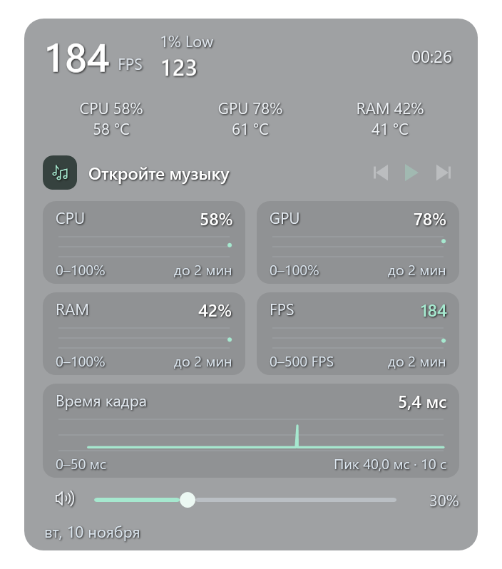

# 1% Low и время кадра

В **«Настройки…» → «Показатели»** доступны отдельные переключатели **1% Low** и **графика времени кадра**. Оба по умолчанию выключены и сохраняются независимо от обычного FPS. Если используются профили игр, выбор сохраняется в активный профиль.

1% Low отображается в свёрнутом HUD и раскрытой панели. FrameView определяет его как средний FPS для самых медленных 1% кадров; методика описана в [официальном руководстве NVIDIA](https://images.nvidia.com/content/geforce/technologies/frameview/frameview-2-0-user-guide-web-version.pdf). Luma читает отдельную метрику SDK `eFPSLow` и показывает рассчитанное источником значение. Этот показатель помогает замечать редкие просадки, которые теряются за высоким средним FPS. При недоступных данных отображается прочерк и причина в подсказке.

График времени кадра находится в раскрытой панели и показывает последние **10 секунд** в миллисекундах. Его можно включить без мини-графиков CPU/GPU/RAM. Источник — реальное поле FrameView `MsBetweenPresents`, интервал между вызовами Present игры. Показатель относится к подаче кадров игрой; время работы GPU и задержка ввода измеряются отдельными метриками.

Чем выше пик, тем дольше интервал соответствующего кадра. График строится по отдельным кадрам; уменьшение числа точек для отрисовки сохраняет минимумы и максимумы, включая короткие пики. Прочерки и разрывы обозначают отсутствие данных.

*Снимок приложения с демонстрационными данными: одиночный пик 40 мс при обычном интервале 5,4 мс.*

При смене источника кадров история начинается заново. Недоступные данные обозначаются разрывом, чтобы не соединять разные игровые потоки в одну линию.

## Источник

Используется уже установленный NVIDIA FrameView SDK. Luma не распространяет его DLL, сборщики или драйверы. Доступность показателей зависит от установленной версии SDK и наличия данных игры; проверяется при подключении.

Скрытие HUD в трей приостанавливает сбор игровых показателей. Выключение новых компонентов убирает их из интерфейса; когда все FPS-показатели выключены, сессия источника закрывается. Остальные компоненты HUD продолжают работать согласно своему выбору.
