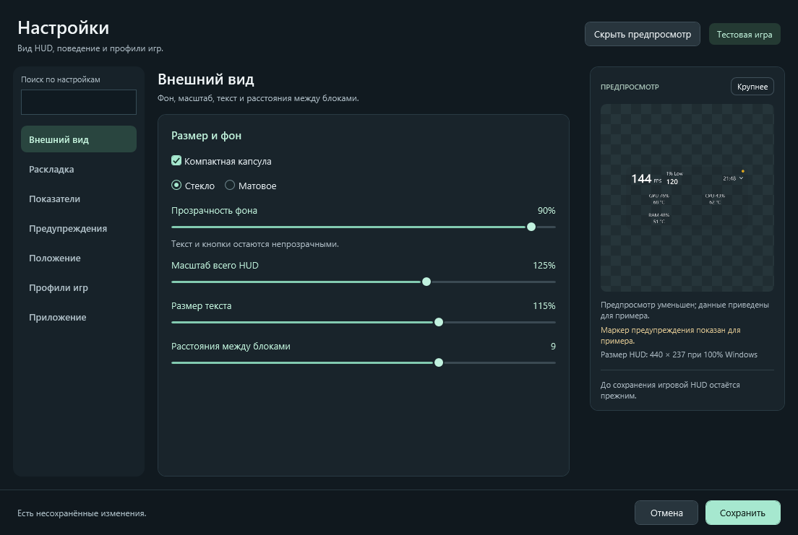
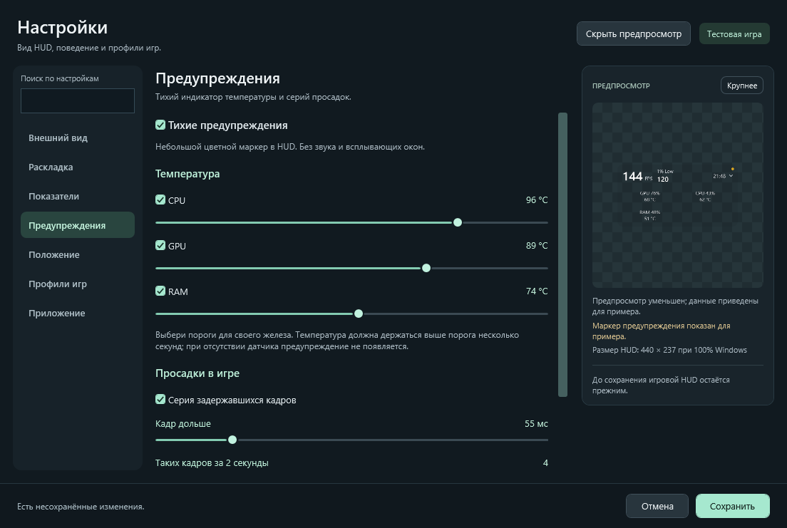

# Редактор HUD и тихие предупреждения

Откройте **правый щелчок по HUD или значку Luma в трее → «Настройки…»**. Вверху указано, что редактируется: общий HUD или профиль активной игры. Разделы **«Внешний вид»**, **«Раскладка»**, **«Показатели»** и **«Предупреждения»** находятся в боковой навигации; их можно найти поиском. [Все разделы и сохранение](settings.md). Если включён пропуск кликов, верните управление через значок в трее или `Ctrl+Alt+I`.

## Собрать свой вид

В редакторе можно:

- переставлять блоки заголовка, показателей и музыки в свёрнутой капсуле;
- менять порядок CPU, GPU и RAM;
- выбирать 1, 2 или 3 показателя в строке;
- менять размер текста от 80% до 130% и интервалы от 2 до 12 DIP;
- выбирать обычную или компактную капсулу, общий масштаб, фон и его прозрачность;
- включать нужные компоненты, включая 1% Low, график времени кадра и температуры.

Порядок блоков относится к свёрнутой капсуле. Раскрытая панель сохраняет свои карточки, графики и управление музыкой; порядок показателей и размер текста учитываются и в ней. Крупные значения заголовка подгоняются по доступной ширине. При нехватке места на экране HUD подстраивает фактический масштаб, сохраняя выбранное пользователем значение.

Предпросмотр использует тот же интерфейс HUD и **демонстрационные значения**: это пример оформления, а не текущие FPS, температуры или состояние плеера. Для него не запускаются FrameView, сборщики нагрузки и температур или отдельная медиасессия. Маркер предупреждения в примере также не означает реальную проблему.

Предпросмотр уменьшен; выбранный масштаб меняет его размер относительно области просмотра.

*Демонстрационный черновик. Предпросмотр показывает примерные значения.*

Нажмите **«Сохранить»**, чтобы применить черновики всех разделов. **«Отмена»** или закрытие окна их не применяют. Пока окно открыто, автоматическое переключение профиля приостановлено. При сохранении правки относятся к исходному активному профилю; если в черновике выключить автоматику, текущий вид становится общим. При удалении активного профиля возвращается обычный HUD. Подробные правила — в [описании настроек](settings.md). Пропуск кликов остаётся отдельной общей настройкой.

При обновлении прежний вид сохраняется: исходная раскладка соответствует трём показателям в строке, тексту 100% и интервалам 6 DIP.

## Тихий маркер

Предупреждения включаются общим переключателем **«Тихие предупреждения»**. По умолчанию он выключен. Ниже можно независимо выбрать температуры CPU, GPU и RAM, а также серию задержавшихся кадров. Для каждой температуры задаётся собственный порог.

*Показанные пороги выбраны для проверки интерфейса, а не как рекомендация для оборудования.*

При срабатывании в углу HUD появляется небольшой янтарный маркер. Подсказка показывает причину и значения; для температуры на 5 °C и более выше выбранного порога используется красный оттенок. Звуков, уведомлений Windows и всплывающих окон нет.

Пороги — настройки пользователя для его оборудования. Значения в редакторе не являются универсальными допустимыми температурами и не заменяют сведения производителя.

### Температура

Температура должна **оставаться не ниже выбранного порога не менее 4 секунд** по последовательным измерениям. Уже активный сигнал снимается после снижения до порога минус 3 °C или ниже: это уменьшает переключения маркера около одного значения.

Если датчик недоступен или измерение некорректно, предупреждение не возникает. При отсутствии свежих температур более 6 секунд состояние сбрасывается. Прочерк или потеря датчика сами по себе не считаются перегревом. Доступность температур описана в [модуле CPU/RAM](sensors.md) и [README для GPU](../README.md#температура-gpu).

### Серия задержавшихся кадров

Задайте порог интервала кадра в миллисекундах и число таких кадров за 2 секунды — от 2 до 10. Учитываются реальные отдельные интервалы Present игры, достигшие выбранного порога, а не усреднённый FPS. Сигнал удерживается 3 секунды после подходящей серии и может продлеваться следующими медленными кадрами.

При смене потока игры или потере данных история серии сбрасывается. Недоступные кадры не заменяются нулями или вымышленными просадками. Источник и ограничения измерения описаны в [документе о времени кадра](frame-timing.md).

## Источники и расход

Предупреждение может требовать температуру или кадры, даже когда соответствующее число или график скрыты в компонентах. Если общий переключатель включён, сбор запускается для отмеченных категорий. Например, предупреждение о просадках использует FrameView и при выключенном графике времени кадра. Это отображено в редакторе.

Используются существующие сборщики приложения: одна служба показателей и одна сессия FrameView. Дополнительных параллельных сборщиков и постоянного опроса для маркера нет. Для снятия уже активного сигнала используется один таймер до ближайшего истечения; при отсутствии предупреждения он остановлен. История медленных кадров ограничена 64 записями.

Скрытие HUD в трей приостанавливает сбор показателей и сбрасывает маркер. Выключение предупреждений прекращает их запросы к источникам; источники продолжают работать, если нужны включённым числовым компонентам. Настройки редактора и предупреждений сохраняются локально вместе с оформлением и [профилями игр](profiles.md).
