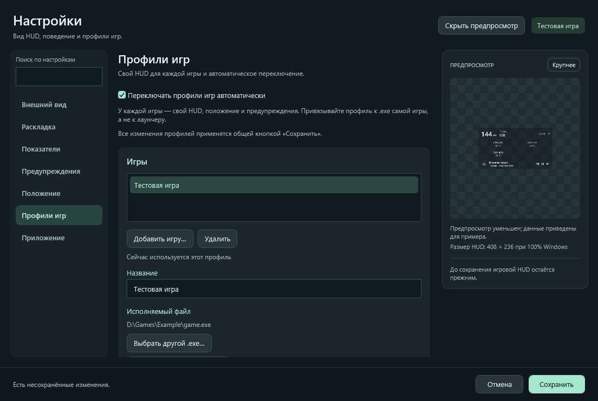

# Профили игр

Для каждой игры можно сохранить положение и экран, прозрачность стекла, масштаб HUD, набор компонентов и интерактивную раскладку капсул. Автопереключение **по умолчанию выключено**.

Игровые привязки теперь редактируются в [едином окне настроек](settings.md), вместе с остальными черновиками HUD.

*Тестовая игра и путь к исполняемому файлу приведены для примера.*

## Создание профиля

1. Настройте HUD так, как он должен выглядеть в игре: положение, прозрачность, размер и показатели.
2. Выберите **«Настройки…» → «Профили игр»** из меню HUD или значка Luma в трее.
3. Нажмите **«Добавить игру…»** и выберите `.exe` самой игры. Новый профиль запомнит текущий HUD; название можно изменить.
4. При необходимости включите **«Автоматически переключать профили игр»** и нажмите **«Сохранить»**.

Выбирайте исполняемый файл игры, а не Steam, другой магазин или общий лаунчер. Для одного `.exe` создаётся один профиль. Изменения списка, названий и переключателя до сохранения остаются черновиком: **«Отмена»** и закрытие окна их не применяют.

Чтобы обновить профиль заранее, настройте черновик HUD, перейдите в **«Профили игр»**, выберите игру и нажмите **«Скопировать текущий HUD»**, затем **«Сохранить»**. Удаление профиля тоже применяется только после сохранения.

## Автоматическое переключение

Когда автоматическое переключение включено, Luma отслеживает только настроенные игры. При запуске игры применяется её профиль, даже если счётчик FPS выключен. Если одновременно работают несколько игр, приоритет получает игра с активным окном; при переходе в браузер или другое приложение профиль работающей игры остаётся выбранным.

Изменения положения, прозрачности, масштаба и компонентов сохраняются в **активный профиль игры**. После завершения игры Luma возвращает общие настройки HUD или профиль другой работающей игры.

Если выключить автопереключение вручную, HUD **останется в текущем положении и виде**. Дальнейшие изменения сохраняются обычным способом, как до появления профилей. Когда автоматическое переключение выключено, отслеживание игр остановлено.

Пропуск кликов и способы возврата управления остаются общими для приложения: `Ctrl+Alt+I`, значок трея и повторный запуск Luma. Они не переключаются вслед за профилем игры. Автозапуск приложения также остаётся общей настройкой.

## Размер и хранение

Масштаб **75–150%** меняет весь HUD, включая кнопки и текст. При нехватке места на экране фактический размер ограничивается рабочей областью, а выбранный масштаб сохраняется.

Профили хранятся локально в `%LOCALAPPDATA%\LumaIsland\profiles.json`. Привязка к `.exe` сохраняется и при временном отсутствии файла игры: после переноса игры выберите для профиля новый исполняемый файл.
