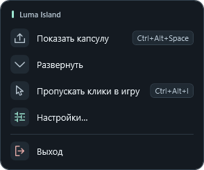
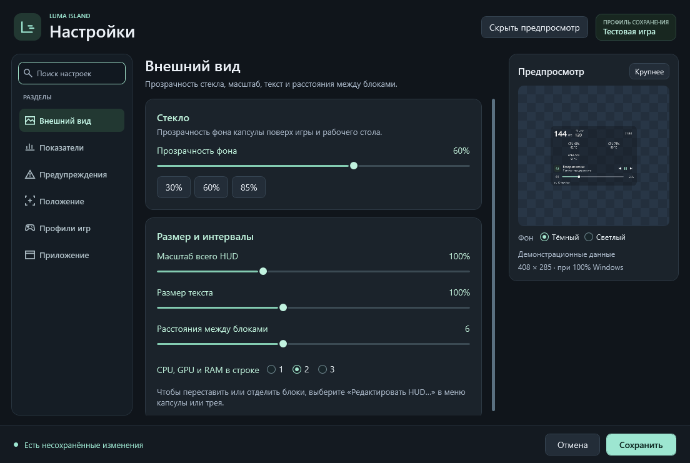

# Настройки Luma Island

Откройте **правый щелчок по HUD или значку в трее → «Настройки…»**. В контекстном меню оставлены быстрые действия: показать/скрыть, раскрыть/свернуть, пропускать клики, открыть настройки и выйти. Горячие клавиши `Ctrl+Alt+Space` и `Ctrl+Alt+I` продолжают работать.

## Найти нужный раздел

Слева находится навигация. Поиск учитывает название, описание и ключевые слова раздела: например, `прозрачность`, `FPS`, `температура`, `экран`, `автозагрузка`. Поиск фильтрует разделы; переключение между ними сохраняет текущий черновик.

Если содержимое не помещается, появляется вертикальная полоса прокрутки. Колёсико прокручивает страницу над полями и ползунками; список профилей прокручивается отдельно и передаёт прокрутку странице на своей границе.

| Раздел | Что настраивается |
|---|---|
| Внешний вид | Стекло или матовый фон, прозрачность, компактность, общий масштаб, размер текста и интервалы |
| Раскладка | Порядок блоков и CPU/GPU/RAM, число показателей в строке, отдельный островок музыки |
| Показатели | Музыка, громкость, время, дата, батарея, нагрузка, температуры, FPS, 1% Low и графики |
| Предупреждения | Тихий маркер температур и серии задержавшихся кадров, категории и пороги |
| Положение | Монитор, девять привязок, свободные координаты и закрепление |
| Профили игр | Добавление и удаление игр, названия, пути к `.exe`, копирование текущего HUD и автоматика |
| Приложение | Регистрация автозапуска, переход к настройке датчиков и напоминание горячих клавиш |

Предпросмотр показывает настоящее оформление HUD с демонстрационными значениями. Примерные FPS, температуры и название трека не являются текущими измерениями. Для предпросмотра не запускаются FrameView, отдельные сборщики или медиасессия. Маркер в примере поясняется подписью. Размер изображения уменьшен под окно; ползунок общего масштаба заметно меняет его размер.

*Снимок тестового окна. Профиль и значения в предпросмотре демонстрационные.*

## Сохранение и отмена

Кнопка **«Сохранить»** подтверждает черновики всех разделов. **«Отмена»** и закрытие окна не применяют эти изменения: внешний вид, положение, компоненты, игровые привязки и автозапуск остаются прежними. Пока окно открыто, автоматическое переключение игрового профиля приостановлено. Вверху указан исходный объект редактирования — общий HUD или профиль активной игры.

- Если при открытии был выбран общий HUD, его оформление, показатели и положение сохраняются как общие настройки.
- Если активная игра осталась в списке и автоматика включена, итоговый HUD записывается в её профиль вместе с остальными изменениями списка. Настройки других игр сохраняются отдельно.
- Если выключить автоматику, сохранив активную игру в списке, итоговый вид также остаётся в её профиле и становится текущим общим HUD.
- Если удалить активный профиль, после сохранения возвращается обычный HUD. Черновик удалённой игры не переносится в общие файлы оформления или положения.

Пропуск кликов остаётся общей настройкой и быстрым действием контекстного меню; игровые профили не переключают его. При ошибке записи Luma сообщает, что сохранить изменения полностью не удалось: состояние на экране и данные для следующего запуска могут различаться.

### Отдельные островки

В разделе **«Раскладка» → «Отдельные островки»** можно отделить музыку и громкость. После сохранения основной HUD содержит показатели, часы и графики, а дополнительный — плеер и громкость. Каждый островок можно раскрыть и переместить независимо. Свободное перетаскивание доступно при выключенном закреплении и пропуске кликов; управляющие кнопки продолжают управлять плеером.

Оформление, прозрачность, масштаб, компактность и закрепление общие. Скрытие в трей и восстановление действуют на оба окна; пропуск кликов и его восстановление также переключаются вместе. Дополнительное окно не показывается, если и музыка, и громкость выключены. В предпросмотре настроек не создаются дополнительные окна поверх рабочего стола.

Режим и отдельное положение сохраняются вместе с раскладкой в общем HUD или активном профиле игры. Выключение режима объединяет панели, не стирая отдельное положение; сброс положения возвращает начальное размещение возле основного HUD. Изменения флажка и сброса положения остаются черновиком до **«Сохранить»**. По умолчанию режим выключен.

### Положение

Выберите экран и привязку либо задайте свободное положение ползунками X/Y. **«Закрепить положение»** защищает от случайного перетаскивания. Правки этой страницы применяются после сохранения; переключение раздела или отмена не двигают настоящий HUD. Если выбранный монитор недоступен, используется доступный основной экран.

### Профили

**«Добавить игру…»** выбирает `.exe` самой игры и создаёт профиль из текущего черновика HUD. Для существующей игры можно изменить название, выбрать другой `.exe`, удалить профиль или нажать **«Скопировать текущий HUD»**. Изменения, включая флажок автоматического переключения, подтверждаются общей кнопкой сохранения. [Как выбирается активная игра](profiles.md).

### Автозапуск и датчики

Автозапуск относится ко всему приложению. Флажок на странице **«Приложение»** управляет его регистрацией после сохранения. Если Windows отдельно отключила запуск, это состояние отображается рядом: Luma не отменяет его автоматически. Кнопка **«Автозагрузка в Windows…»** открывает системную страницу.

Кнопка **«Настроить модуль датчиков…»** открывает отдельное окно. Само открытие только проверяет состояние установки. Установка и удаление в этом окне — отдельные действия с запросом прав администратора; они выполняются сразу и не отменяются кнопкой «Отмена» в основных настройках. [Модуль CPU/RAM](sensors.md).

## Добавление разделов в исходном коде

Навигация использует `SettingsSectionRegistry` и `SettingsSectionDefinition`. Раздел имеет стабильный ID, название, описание, ключевые слова и фабрику содержимого. Страница создаётся один раз при первом выборе; для захвата черновика, проверки значений и освобождения ресурсов предусмотрены отдельные обработчики. `HudEditorWindow.RegisterSection` добавляет раздел без изменения контекстного меню.

Это расширение интерфейса в исходном коде: загрузки сторонних DLL, сканирования каталогов расширений или выполнения внешних скриптов нет. Порядок сохранения сосредоточен в `SettingsCommitPlan`; системные действия, такие как установка датчиков, остаются явными отдельными командами. [Архитектура](architecture.md).
